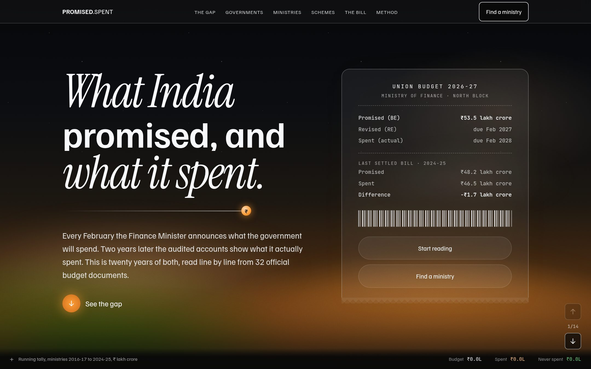
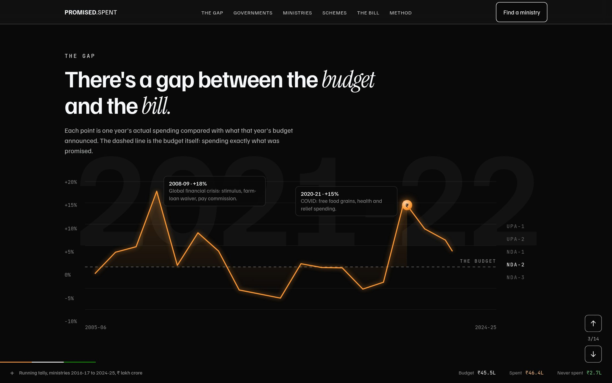
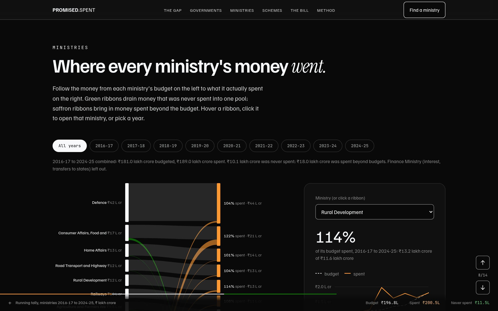
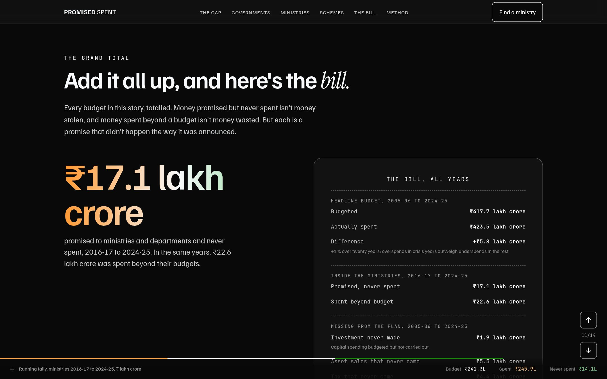
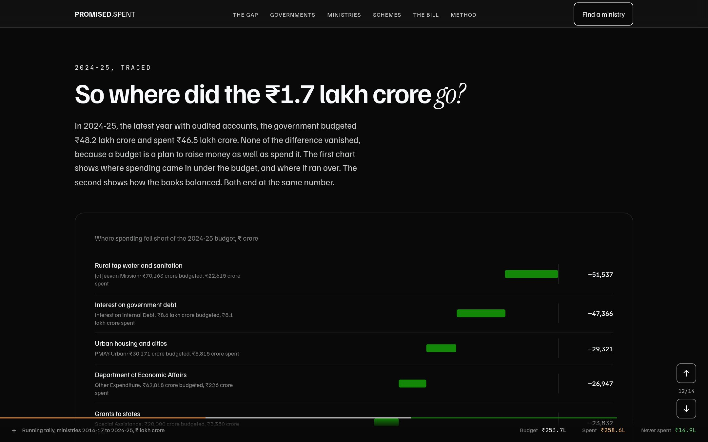
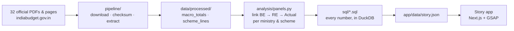

<div align="center">

# Promised vs Spent

**What India's Union Government promised in its Budgets, and what it actually spent, 2005 to 2025.**

Twenty years of budgets, read line by line from 32 official documents,<br>
then told as a story that ends with the bill.

### [**Read the story →**](https://india-budget-promised-vs-spent.vercel.app)

<a href="https://india-budget-promised-vs-spent.vercel.app"></a>

</div>

---

Every February the Finance Minister announces what the government will spend. Two years later the audited
accounts show what it actually spent. The two numbers rarely match, and the gap is printed in plain sight
in the government's own documents, if you are willing to read a few thousand pages of them.

This project does that reading. It extracts every ministry and scheme from the Budget documents of 2005-06
to 2026-27, links each year's promise to its revised estimate and its audited actual, and asks three
questions: **how far does spending drift from the budget, where does it drift most, and has that changed
between governments?** The question is framed neutrally: the same yardstick is applied to every government.

## What it found

All money in ₹ crore; 1 lakh crore = ₹1,00,000 crore.

1. **Over twenty years the totals almost match.** From 2005-06 to 2024-25 the Budgets promised
   **₹417.7 lakh crore** and the government spent **₹423.5 lakh crore**, 1.4% more. The years that ran far
   over were crises: 2008-09 (+18%, the financial crisis) and 2020-21 (+15%, COVID).
2. **Inside the ministries, the money moves a lot.** From 2016-17 to 2024-25, **₹17.1 lakh crore** promised
   to ministries was never spent, while **₹22.6 lakh crore** was spent beyond their budgets.
3. **Underspending has become more common.** Before 2020, about 1 in 5 schemes spent less than three
   quarters of its budget. Since COVID it has been about 1 in 3.
4. **The plan's funding side misses too.** Over twenty years, asset sales (disinvestment) brought in
   ₹5.5 lakh crore less than budgeted, tax ₹4.4 lakh crore less, and ₹1.9 lakh crore of planned capital
   investment was never made. The government borrowed ₹14.8 lakh crore more than it planned.
5. **2024-25, traced rupee by rupee.** The budget promised ₹48.2 lakh crore and ₹46.5 lakh crore was spent:
   ₹1.7 lakh crore less. The biggest shortfalls were rural tap water (Jal Jeevan Mission: ₹70,163 crore
   budgeted, ₹22,615 crore spent) and urban housing (PMAY-Urban: ₹30,171 crore budgeted, ₹5,815 crore spent).
6. **So did money go missing? No, and that's the point.** A budget line is permission to spend, not cash in a
   ministry's account. Unspent money is never paid out; the government simply borrows less. What the budget
   can't show is whether the money that *was* spent was delivered well. That is where the record goes thin.

## A look inside

<table>
  <tr>
    <td width="50%"><br><sub><b>The gap.</b> Each year's actual spending against its budget, drawn as you scroll, with each government in turn.</sub></td>
    <td width="50%"><br><sub><b>Where every ministry's money went.</b> A Sankey from budget to spending; unspent money drains to one pool. Click any ministry.</sub></td>
  </tr>
  <tr>
    <td width="50%"><br><sub><b>The bill.</b> Twenty years added up: budgeted, spent, never spent, and spent beyond budget.</sub></td>
    <td width="50%"><br><sub><b>Where did ₹1.7 lakh crore go?</b> A two-part waterfall: where spending fell short, then how the books balanced.</sub></td>
  </tr>
</table>

## How it works



- **Nothing is typed in by hand** except one page that has no text layer, and that transcription says how it
  was checked. Every other number is extracted from the original files, which are kept unedited in
  `data/raw/` with their URLs and SHA-256 checksums.
- **The pipeline refuses to produce wrong numbers.** Every statement must satisfy the budget's own accounting
  identities, every ministry must add up to its printed total, and the two kinds of document must agree with
  each other to the crore. If any check fails, no CSV is written. The full list is below.
- **Every number is computed in SQL.** Once the documents are linked, each question is one file in `sql/`,
  run with DuckDB: the yearly panel, each government's scorecard, the ministry ranking, how often schemes
  underspend, the ₹100 grid (with largest-remainder rounding in window functions), the grand total and the
  waterfall. Each chart on the site has a **"Show the SQL"** panel with the exact query behind it.
- **Only one step stays in Python:** matching each scheme from one year's document to the next. It walks the
  printed lines in order and falls back from name to amount, which is a loop, not a query.
- **The story app reads one file,** `app/data/story.json`, so every figure on the site can be traced back to
  a SQL query and a page of a government PDF.

**Built with:** SQL (DuckDB) for the analysis; Python and `pdftotext` for extraction and checks; Next.js,
TypeScript, Tailwind CSS and GSAP for the story.

## Run it yourself

```bash
uv sync                                  # DuckDB, the only Python dependency
pipeline/run_all.sh                      # download, extract (needs poppler's pdftotext), link, run sql/
cd app && pnpm install && pnpm dev
```

## Project structure

```
02-india-budget/
├── README.md                   you are here
├── docs/preview/               screenshots used in this README
├── pipeline/                   code; run in order, or all at once with run_all.sh
│   ├── sources.py              every external file: URL and what it is used for
│   ├── 01_download.py          fetches sources into data/raw/, writes MANIFEST.csv
│   ├── 02_extract_macro.py     Budget at a Glance → data/processed/macro_totals.csv
│   ├── 03_extract_schemes.py   Expenditure Budget → data/processed/scheme_lines.csv
│   └── run_all.sh              rebuilds data/ end to end; fails if any check fails
├── analysis/                   code; run after the pipeline
│   ├── panels.py               links ministries and schemes across documents → data/analysis/{ministry,scheme}_by_year.csv
│   ├── flagships.py            name patterns that define the 21 flagship schemes (auditable list)
│   └── findings.py             runs sql/ with DuckDB and writes app/data/story.json
├── sql/                        every number in the story, one question per file
│   ├── 00_sources.sql          views over the CSVs, and the year → government rule
│   ├── 01_macro_by_year.sql    BE, RE and Actual for every headline metric and year
│   ├── 02_government_scorecard.sql   median gaps per government
│   ├── 03_ministries.sql, 04_ministry_explorer.sql   ranking and year-by-year drill-down
│   ├── 05_underspending.sql, 06_underspending_totals.sql   how often programmes underspend
│   ├── 07_publicity.sql        publicity and advertising lines
│   ├── 08_every_100_rupees.sql the ₹100 grid, largest-remainder rounding
│   ├── 09_the_bill.sql         the grand total
│   └── 10_waterfall_spending.sql, 11_waterfall_funding.sql   the latest year, traced
├── app/                        the story app (Next.js + GSAP); reads only app/data/story.json
│   ├── app/page.tsx            the chapters, all copy and numbers computed from story.json
│   ├── components/             Hero, GapLine, GovStepper, Waffle, MinistrySankey, ReadoutChart, GrandTotal, TallyFooter, charts/
│   └── components/motion/      GSAP setup (skipped for reduced-motion readers) and the Reveal wrapper
└── data/
    ├── raw/                    original government files, never edited (100 MB)
    │   ├── MANIFEST.csv        file, source URL, purpose, size, SHA-256, download time
    │   ├── budget_at_a_glance/ 22 files, budgets 2005-06 to 2026-27
    │   └── expenditure_budget/ 10 files, budgets 2017-18 to 2026-27
    ├── manual/                 hand transcriptions of pages with no text layer (1 page)
    ├── interim/                plain-text copies of the raw files (pdftotext), for reading
    ├── processed/              the clean tables everything downstream uses
    │   ├── macro_totals.csv
    │   └── scheme_lines.csv
    └── analysis/               analysis outputs, one row per fiscal year x thing
        ├── macro_by_year.csv       headline metrics, 2004-05 to 2026-27, with the government in office
        ├── ministry_by_year.csv    each ministry/department, 2016-17 to 2024-25
        ├── scheme_by_year.csv      each scheme, 2016-17 to 2024-25 (13,000+ scheme-years)
        └── flagship_by_year.csv    21 flagship schemes, all their budget lines combined
```

Rebuild everything: `pipeline/run_all.sh` (needs Python 3.12+, `uv` for DuckDB, and `pdftotext` from poppler).

## Sources: what was used for what

All files come from the Ministry of Finance's budget site, [indiabudget.gov.in](https://www.indiabudget.gov.in).
`data/raw/MANIFEST.csv` has the exact URL and checksum of each one.

| Raw files | What they are | Used for |
|---|---|---|
| `budget_at_a_glance/<budget>.pdf/.htm` | Statement 1 of *Budget at a Glance*: headline receipts, expenditure and deficits. Each budget prints four columns: Actuals (2 years back), BE and RE (last year), BE (this year). | `macro_totals.csv`: total, revenue and capital spending, interest, deficits. BE vs RE vs Actuals for every year from 2003-04. |
| `expenditure_budget/<budget>.pdf` | *Expenditure Budget* (Notes on Demands for Grants): every ministry and department, scheme by scheme, with Actuals, BE, RE and next year's BE. 300–400 pages a year. | `scheme_lines.csv`: which ministries and schemes are under- or over-spent. Starts at 2017-18, when plan/non-plan accounting was abolished, so all years use the same format. |
| `manual/expenditure_budget_2022-23_page174.txt` | Hand transcription of one page (Health ministry, National Health Mission) that the PDF draws as vector outlines with no extractable text. | Spliced into the 2022-23 parse. Its header explains how it was checked. |

**BE** = Budget Estimate (announced in February), **RE** = Revised Estimate (mid-year revision),
**Actual** = audited spending, published two years later. All money is in ₹ crore.

## The processed tables

### `macro_totals.csv` (1,068 rows)

| Column | Meaning |
|---|---|
| `budget` | Which Budget at a Glance the number was read from |
| `fiscal_year` | The year the number is about |
| `estimate` | `BE`, `RE`, `Actual`, or `Provisional Actual` (the July 2024 budget prints one extra column) |
| `metric` | `revenue_receipts`, `tax_revenue_net`, `non_tax_revenue`, `recoveries_of_loans`, `other_receipts`, `total_expenditure`, `revenue_expenditure`, `capital_expenditure`, `interest_payments`, `revenue_deficit`, `fiscal_deficit`, `primary_deficit` |
| `value_crore` | ₹ crore; blank where the budget prints "..." (nil) |
| `source` | Raw file it came from |

A year's BE comes from that year's budget, its RE from the next budget, and its Actual from the budget two
years later.

### `scheme_lines.csv` (31,389 rows)

One row per line of each ministry's allocation table ("A. The Budget allocations").

| Column | Meaning |
|---|---|
| `budget` | Expenditure Budget it came from |
| `ministry`, `demand_no`, `demand` | Ministry, demand number and department name |
| `part`, `section` | Headings above the line, e.g. `CENTRE'S EXPENDITURE` / `Central Sector Schemes/Projects` |
| `row_type` | `item` (numbered scheme), `sub` (N.NN sub-line), `unlabelled` (a recoveries line printed without a label), `other`, `net` (nets the lines above it), `total` (a subtotal) |
| `item_id`, `label`, `parent_label` | Line number as printed, its name, and the scheme a sub-line or Net belongs to |
| `fy_actual`, `fy_prev`, `fy_budget` | The years the four column groups refer to |
| `actual_*`, `be_prev_*`, `re_prev_*`, `be_*` | Revenue, capital and total for Actual (`fy_actual`), BE and RE (`fy_prev`), and BE (`fy_budget`) |

To get one number per scheme, use its `net` row if it has one, otherwise its `item` row. Don't add up
`net` and `total` rows together with the lines they summarise.

## How the extraction is checked

Each script exits with an error if any of these checks fails, so the CSVs only exist if all of them pass.

- **Accounting identities** for every column of all 22 Budget at a Glance statements: total = revenue + capital
  expenditure; fiscal deficit = expenditure − non-debt receipts; primary deficit = fiscal deficit − interest;
  revenue receipts = tax + non-tax.
- **The same BE printed twice agrees:** each year's BE appears in its own budget and again in the next one,
  and all 251 pairs match.
- **Every ministry's lines add up to its Grand Total,** and the Grand Total equals the net figure at the top of
  that ministry's first page. All 1,011 ministry-years pass.
- **Every Net row equals the lines it nets.**
- **The two documents agree with each other:** the sum of all ministries' lines equals Budget at a Glance's total
  expenditure for BE, RE and Actuals in all 10 overlapping budgets, to the crore.
- **Spot checks against well-known figures:** 2024-25 capex BE ₹11,11,111 crore; 2022-23 actual expenditure
  ₹41,93,157 crore; PM-Kisan BE 2026-27 ₹63,500 crore.

## Known quirks in the source documents

- **Interim budgets are skipped.** In election years (2009-10, 2014-15, 2019-20, 2024-25) only the full
  July budget is used.
- **The July 2024 budget has five columns.** It adds "Provisional Actuals 2023-24"; the extractor detects this
  from the header.
- **2019-20's Budget at a Glance statement page is a scanned image,** so the full 2019-20 document (same table,
  real text) is used instead.
- **2008-09 to 2010-11 were published as HTML pages,** not PDFs.
- **The actuals printed in the 2020-21 and 2021-22 budgets are flagged as provisional** in the documents'
  footnotes.
- **Charged expenditure (interest payments, repayment of debt) is headed "No. n (APPROPRIATION)"**, not
  "DEMAND NO. n". Both are included.
- **MGNREGA appears to be replaced in 2026-27** by "Viksit Bharat-Guarantee for Rozgar and Ajeevika Mission
  (Gramin)". Scheme names change over time, so the analysis will need a scheme-matching table.

## Analysis method

- **Which number for which year.** A year's BE comes from that year's own budget at the macro level. At
  scheme and ministry level, BE(t) and RE(t) come from the Expenditure Budget of t+1 and Actual(t) from the
  one of t+2, so all three are already restated for any reorganisation in between.
- **Linking documents.** Ministries and schemes are matched between consecutive documents by name. Where a
  name changed, the match falls back to the BE(t+1) figure, which both documents print. Linked schemes
  cover 94–99.9% of each year's budgeted money, and linked ministries add up to total expenditure for every
  year except 2016-17 (98%, a ministry merger).
- **Ministry names.** Renames and spelling slips are mapped to today's names in `panels.py`
  (`MINISTRY_NAMES`), e.g. Human Resource Development → Education.
- **Flagship schemes.** A scheme is often several printed lines (fund transfers, one line per funding source).
  Generic lines such as a bare "Programme Component" are matched by the heading they sit under, and patterns
  allow for the documents' own misspellings ("Gaurantee"); checked against published MGNREGA figures.
  `flagships.py` lists the name pattern for each of the 21 schemes, and their lines are summed within each
  document, so restructuring between years doesn't lose money.
- **Programme statistics** (how often schemes underspend) leave out fund-transfer and accounting lines, and
  the Finance and Railways ministries, whose lines are mostly transfers, debt service and commercial accounts.
- **Governments.** Each fiscal year is assigned to the government that presented its budget: UPA-1 to
  2008-09, UPA-2 to 2013-14, NDA-1 to 2018-19, NDA-2 to 2023-24, NDA-3 after.

Run: `python3 analysis/panels.py && uv run python analysis/findings.py`

## The story app

A scroll-driven data story in a "midnight terminal" style lit in the Indian flag's colours (dark canvas, saffron
for spending and overruns, green for money left unspent, white for the budget line), framed as a bill:
the hero is a receipt for the newest budget and the story ends with the grand total. Motion uses GSAP +
ScrollTrigger: a pinned gap chart drawn by the scroll, stamped chapter rows that decode, a government-by-
government stepper, a pinned "every ₹100" grid that lights up category by category, a Sankey of every
ministry's budget flowing into its spending (unspent money drains to one pool, top-ups flow in from another)
with a drill-down panel, a receipt that prints the totals, a two-part waterfall tracing the latest year's
shortfall (where spending fell short, then how the books balanced; both land on the same number), and a
footer tally that fills up as you scroll. It closes with "The limits": what the budget can and can't show
(unspent money never leaves; spending is audited; but delivery, reserve funds, off-budget bills and funds
outside the budget are where the record goes thin). Every animation's
end state is what the server renders, so readers with reduced motion (or no JavaScript) see the full story.
Fonts are free stand-ins for the reference's commercial faces: Familjen Grotesk, JetBrains Mono, Instrument Serif.
